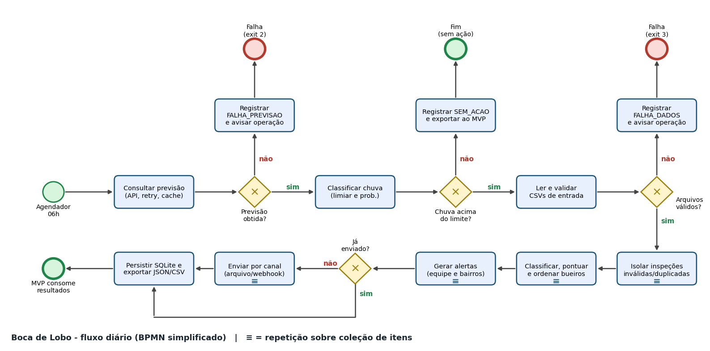

# Boca de Lobo

> FIAP Global Solution 2026.2 · CitizenTech · Robotic Process Automation – *Do Processo Manual à Automação Inteligente*

O **Boca de Lobo** combina a inspeção visual de imagens com a previsão de chuva e o risco da área. O RPA consome a fila produzida pelo componente de Visão Computacional, aplica regras de negócio, gera uma lista priorizada e prepara rascunhos de alerta para revisão humana. Este repositório contém uma integração local reproduzível; não há ainda MVP público nem envio automático de alertas a moradores.

## Integrantes

| Nome completo | RM |
|---|---|
| Açussena Macedo Mautone | 552568 |
| Felipe Heilmann Marques | 551026 |
| Felipe Voidela Toledo | 98595 |
| Carlos Eduardo Caramante Ribeiro | 552159 |
| Ian Cancian Nachtergaele | 98387 |

## Ficha Técnica do MVP

| Campo | Descrição |
|---|---|
| Nome do produto | Boca de Lobo |
| Cidadão e território | Moradores de bairros alagáveis da Zona Leste/Sul de São Paulo (Mooca, Ipiranga, Vila Prudente, Penha, Tatuapé, Cambuci) e as equipes de zeladoria que atendem esses bairros |
| Problema (1 frase) | Bocas de lobo entupidas por lixo e folhas transformam chuvas fortes em alagamentos, e hoje a identificação e o aviso são manuais e chegam tarde |
| Proposta de valor | Antecipar o risco antes do temporal: a equipe sabe **quais bueiros limpar primeiro** e o morador sabe **onde não passar** |
| Arquitetura | Imagens → detector YOLO e avaliação visual (**Applied Computer Vision**) → `action_queue.json` + áreas → **RPA Python** (previsão, validação, priorização) → SQLite/JSON/CSV + API local de leitura → futuro MVP |
| Fontes de dados | Open-Meteo (API pública); imagens do Drainage Dataset (CC BY 4.0); inventário e áreas de risco simulados/documentados pelo componente de Visão. Dados sintéticos locais são usados apenas nos testes do RPA |
| Modelos de IA | YOLO11n no componente de Visão. O RPA não usa IA: aplica regras explicáveis sobre a estimativa de cobertura visual; ela não mede entupimento interno nem substitui vistoria |
| URL do MVP e repositório | MVP web público: ainda não publicado (protótipo local) · [GitHub](https://github.com/iancancian/GS2026ACV) |
| Indicadores de impacto | Para piloto futuro: bueiros verificados antes da chuva; tempo entre inspeção e limpeza; alertas confirmados em campo; cobertura de áreas periféricas. Ainda não medidos pelo protótipo |
| ODS conectados | **11** Cidades e comunidades sustentáveis · **13** Ação climática · **10** Redução das desigualdades |

**Modelo de negócio (hipótese):** SaaS por bairro/subprefeitura para prefeituras ou concessionárias de drenagem; validar com usuários e contratantes antes de estimar impacto ou escala.

## Como funciona



1. **Entrada da Visão:** `action_queue.json` (schema 1.0) mais `areas_risco.csv`, com avaliações de imagens e `human_approval_required=true`.
2. **Previsão** (Open-Meteo, com retentativas e cache) → decisão: probabilidade `≥ 60%` e (`≥ 30 mm/24h` ou `≥ 20 mm/h`).
3. **Validação e priorização:** converte a cobertura visual estimada, mantém revisão manual para imagens sem bueiro detectado, cruza com risco da área e registra rejeições. Os limiares (10%/80%) correspondem às faixas usadas pela Visão; cobertura 2D não é medida de obstrução interna.
4. **Saídas:** fila da equipe e rascunhos por área, marcados para revisão humana. A localização exata dos ativos não existe no contrato atual; os rascunhos não devem ser publicados como orientação de rota.
5. **Interface para o MVP:** SQLite, JSON/CSV e API local read-only. Contrato verificado por testes locais; não existe ainda dashboard público conectado.

Detalhes, regras e exceções: [`docs/PDD.md`](docs/PDD.md) · BPMN: [`docs/fluxo.bpmn`](docs/fluxo.bpmn).

## Como executar

Requisitos: Python 3.10+.

```powershell
pip install -r requirements.txt
$env:PYTHONPATH = "src"          # ou: pip install -e .

# Demonstração reproduzível (previsão de tempestade em arquivo)
python -m bocadelobo executar --visao-action-queue data/samples/vision_action_queue.json --visao-areas data/samples/areas_risco_visao.csv --previsao-arquivo data/samples/previsao_tempestade.json --agora 2026-11-17T09:00:00+00:00

# Dia seco (nenhuma ação)
python -m bocadelobo executar --visao-action-queue data/samples/vision_action_queue.json --visao-areas data/samples/areas_risco_visao.csv --previsao-arquivo data/samples/previsao_seco.json --agora 2026-11-17T09:00:00+00:00

# Simulação sem enviar alertas nem gravar resultados
python -m bocadelobo executar --previsao-arquivo data/samples/previsao_tempestade.json --dry-run

# Demonstração com previsão real do dia; sem os dois argumentos --visao-*, usa dados CSV simulados
python -m bocadelobo executar

# API somente leitura para o MVP (http://127.0.0.1:8000/api/prioridades | /api/alertas | /api/saude)
python -m bocadelobo servir
```

Códigos de saída: `0` ok · `1` erro inesperado · `2` previsão indisponível · `3` dados de entrada inválidos · `4` configuração inválida.

**Visão → RPA (integração local):** no checkout lado a lado, gere a fila no projeto de Visão com `python -m boca_de_lobo.automation`; execute então o RPA passando `..\ACV\output\action_queue.json` e `..\ACV\data\areas_risco.csv`. Para testes reproduzíveis, o repositório inclui um snapshot reduzido em `data/samples/`, derivado da execução local da Visão (sem imagens nem caixas de detecção). Para recriá-lo: `python scripts\gerar_amostra_visao.py`.

O adaptador aceita apenas `schema_version=1.0`, exige `human_approval_required=true`, preserva rejeições da Visão e envia itens sem detecção para revisão manual. Como a Visão fornece risco binário, o RPA mapeia `high_risk=true` para nível 5 e `false` para nível 2; não inventa histórico de alagamentos ou equipamento sensível. As coordenadas e os nomes de setor da amostra são simulados, não localização operacional.

**Agendamento:** o workflow diário está condicionado à configuração `BL_PRODUCTION_ENABLED=true` e aos caminhos `BL_VISAO_ACTION_QUEUE`/`BL_VISAO_AREAS` como variáveis do repositório. O schedule só deve ser habilitado quando esses arquivos forem atualizados com o feed atual da Visão. Até lá, use `workflow_dispatch` (snapshot de demonstração) ou execução local. Alternativa no Windows: Agendador de Tarefas executando o comando integrado acima às 06h.

**Alertas e aprovação:** por padrão, o RPA grava rascunhos em JSONL; não publica aviso ao cidadão. Um webhook exige `BL_WEBHOOK_URL` e a opção explícita `--aprovar-envio`, apenas depois de revisão humana. O contrato de visão não tem localização exata, portanto não use a saída para orientar rotas reais.

**Configuração:** regras em [`config/regras.json`](config/regras.json); segredos/ambiente em [`.env.example`](.env.example). Não inclua URLs com tokens ou dados de moradores no repositório.

## Estrutura

```
src/bocadelobo/   forecast · inspection · prioritizer · alerts · storage · pipeline · mvp_api · cli
config/           regras de negócio (JSON versionado)
data/             CSV sintéticos para testes + snapshot sanitizado da fila da Visão
docs/             PDD, fluxo BPMN/PNG, relatório técnico (PDF), roteiro do vídeo
assets/           exemplo_saida/ (evidências dos arquivos gerados)
logs/             amostras de logs de 5 cenários
tests/            28 testes automatizados (pytest) + evidências
scripts/          geração de dados, fluxo, relatório e evidências
```

## Testes

```powershell
python -m pytest -q        # 28 testes: integração, sucesso, decisão e falha
```

Cenários, resultados e evidências: [`tests/README.md`](tests/README.md).

## Limitações e próximos passos

- O inventário e os setores de risco são simulados; a cobertura da Visão é uma aproximação por caixas 2D, em imagens de teste, não uma inspeção de campo.
- A integração de entrada com a Visão é executável e testada localmente. O MVP web público e um consumidor externo da API ainda não foram publicados.
- O vídeo demonstrativo será adicionado antes da submissão.
- Não há geolocalização individual, confirmação de limpeza ou medição de impacto. Os valores de economia/impacto não são resultados medidos.

## Segurança e LGPD

Não há dados pessoais de moradores no protótipo; segredos só por ambiente; logs sem conteúdo sensível; API read-only em `127.0.0.1`; aprovação humana antes de qualquer ação ou divulgação. Detalhes no PDD (seção 7).

## Links

- Vídeo demonstrativo: será publicado antes da entrega final
- Repositório: [github.com/iancancian/GS2026RPA](https://github.com/iancancian/GS2026RPA)
